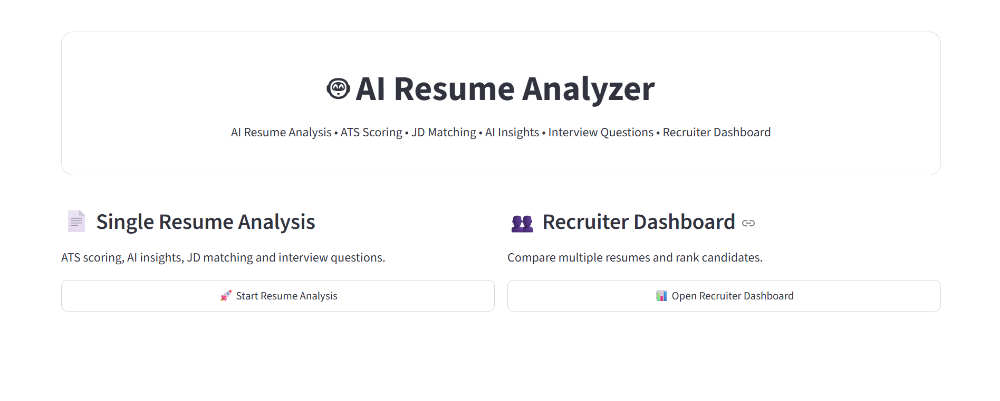
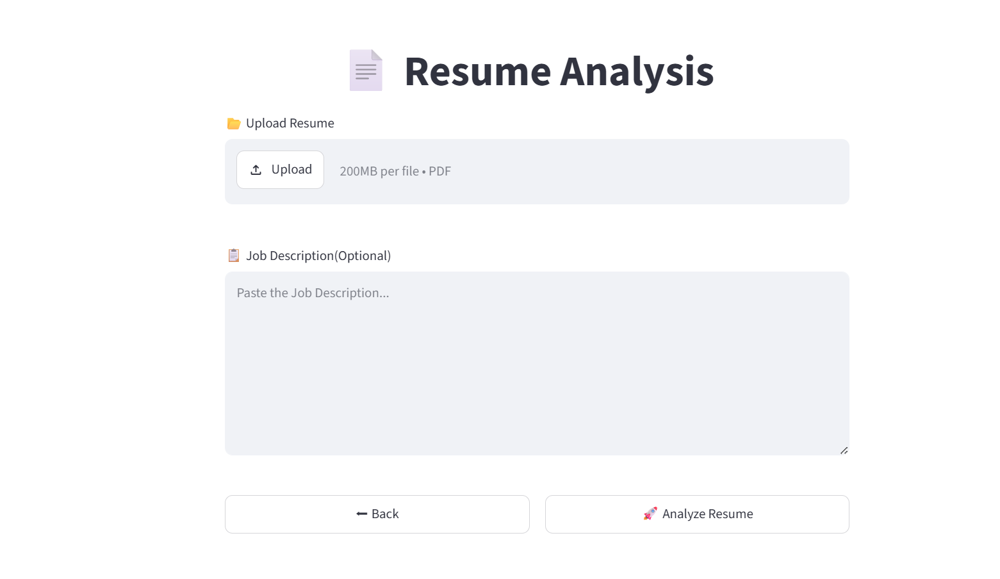
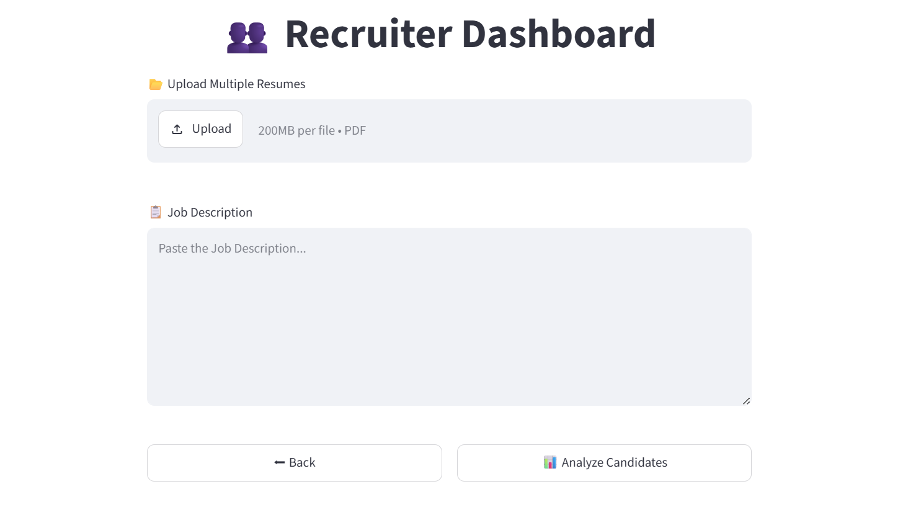

# 🤖 AI Resume Analyzer & Recruiter Dashboard

An AI-powered Resume Analyzer and Recruiter Dashboard built using **Python, Streamlit, and Groq LLM API**. The application helps job seekers evaluate their resumes with ATS scoring and AI-generated feedback while enabling recruiters to compare multiple resumes, rank candidates, and identify the best candidate based on job description matching.

---

## ✨ Features

### 👤 Candidate Resume Analysis
- Upload Resume (PDF)
- ATS Score Calculation
- AI-Powered Resume Analysis
- Resume Summary
- Skill Extraction
- Missing Skills Detection
- Job Description Matching
- Candidate Information Extraction
- Resume Improvement Suggestions
- AI-Generated Interview Questions
- Downloadable PDF Report

### 👨‍💼 Recruiter Dashboard
- Upload Multiple Resumes
- Upload Job Description
- Compare Candidates
- ATS Score Ranking
- Skill Match Analysis
- Missing Skills Comparison
- Candidate Information Display
- Best Candidate Recommendation
- Interactive Dashboard

---

## 🛠️ Tech Stack

- Python
- Streamlit
- Groq API (LLM)
- Pandas
- PyPDF2
- ReportLab
- python-dotenv
- Regular Expressions (Regex)

---
# 📂 Project Structure

```text
AI_Resume_Analyzer_&_Recruiter_Dashboard/
│
├── app.py
├── requirements.txt
├── README.md
├── .gitignore
├── .env.example
│
├── core/
│   ├── db.py               # SQLite engine/session lifecycle (lazy, idempotent)
│   └── models.py           # Candidate, CandidateStatusHistory, JobDescription, ResumeAnalysis (SQLAlchemy)
│
├── data/
│   ├── role_skills.json
│   ├── skills.json
│   └── talentiq.db         # persistent candidate/analysis/JD/shortlist store (auto-created)
│
├── modules/
│   ├── ai_analysis.py
│   ├── ats_score.py
│   ├── candidate_details.py
│   ├── interview_generator.py
│   ├── jd_matcher.py
│   ├── missing_skills.py
│   ├── parser.py
│   ├── pdf_report.py
│   ├── resume_coach.py     # AI Resume Coach (JD-grounded, no-fabrication)
│   ├── resume_profile.py
│   ├── resume_ranker.py
│   ├── resume_validation.py
│   ├── sections.py
│   └── skills.py
│
├── services/
│   ├── semantic_matcher.py  # local offline embeddings (all-MiniLM-L6-v2)
│   ├── skill_matcher.py     # canonical required/preferred skill gap
│   ├── candidate_service.py # create/lookup candidates (dedup by resume hash)
│   ├── recruitment_service.py # status transitions + pipeline counts + history
│   └── analysis_service.py  # persist/retrieve resume analyses
│
├── pages/
│   ├── 1_Resume_Analysis.py
│   ├── 2_Resume_Results.py
│   ├── 3_Recruiter_Dashboard.py
│   ├── 4_Recruiter_Results.py
│   └── 5_AI_Resume_Coach.py
│
├── image.png
├── image-1.png
└── image-2.png
```

---

## 🚀 Installation

### Clone the repository

```bash
git clone https://github.com/your-username/AI_Resume_Analyzer_&_Recruiter_Dashboard.git
```

### Navigate to the project

```bash
cd AI_Resume_Analyzer_&_Recruiter_Dashboard
```

### Install dependencies

```bash
pip install -r requirements.txt            # runtime
pip install -r requirements-dev.txt        # + pytest, to run the tests
```

The JD matcher uses local sentence embeddings (`sentence-transformers` +
`all-MiniLM-L6-v2`). The model is loaded once per session from the Hugging Face
cache (works fully offline). If it is unavailable, matching automatically falls
back to the deterministic skill + TF-IDF signals — the app never crashes and
never sends resume content to an external service for embedding.

The AI Resume Coach (page 5) reuses the same centralized Groq configuration as
the other AI features. It sends one structured request per (resume, JD) — the
result is cached in session state and generated recommendations are grounded in
the resume's verified signals. If the AI call fails, the page falls back to
deterministic, evidence-based recommendations (ATS issues, matched/missing
skills) so it is never blank, and it never tells a candidate to claim
experience, skills, or metrics they do not actually possess.

### Persistent storage (`core/`, `services/`)

Candidates, analyses, job descriptions, and the recruiter shortlist are
persisted in a local SQLite database (`data/talentiq.db`) via a small
SQLAlchemy service layer. Session state is reserved for temporary UI state only
(uploaded file objects, filters, rerun-dedup guards) — the shortlist survives
page re-runs, navigation, refreshes, and app restarts. Duplicate resumes are
detected by SHA-256 of the file bytes (never the filename), so the same resume
re-used across uploads reuses a single candidate row. Recruitment status is a
controlled enum (`New, Analyzed, Shortlisted, Interview, Selected, Rejected`);
score eligibility is **not** a status. Persistence is best-effort: any SQLAlchemy
error is contained and surfaces only as a clean user message, never a traceback.
The database path can be overridden with `TALENTIQ_DB_PATH` — or the
production `DATABASE_URL` (e.g. `sqlite:///data/talentiq.db`), which takes
precedence.

### Recruitment pipeline (status transitions)

Recruiters manage each candidate's status from the Recruiter Results page
independently of AI scores. The typical lifecycle is `New -> Analyzed ->
Shortlisted -> Interview -> Selected`, with `Rejected` as the terminal/review
status, but the workflow is not artificially restrictive: backward moves (e.g.
`Interview -> Shortlisted`) and `Analyzed -> Rejected` are always allowed, and a
candidate with a low score can still be Shortlisted (or a high-scoring one left
as Analyzed) — AI scoring provides intelligence, recruiter status records
decisions. Removing a candidate from the shortlist applies the clean rule
`Shortlisted -> Analyzed` and never deletes the candidate or their scores.
Every actual status change is recorded as an audit row in
`candidate_status_history` (previous status, new status, timestamp). The
Recruiter Results page shows the whole pipeline (`get_pipeline_counts()`) with
real DB counts, a per-candidate status selector, a `Recruitment Status` table
column, and an extra status filter that combines with the existing ATS/JD/Final
Score filters.

### Candidate history & activity timeline

Every meaningful event is appended to an immutable, per-candidate activity
timeline (`candidate_activity`, `CandidateActivity` model):

| Activity type           | When it is recorded                                          |
| ----------------------- | ------------------------------------------------------------ |
| `RESUME_ANALYZED`       | each new analysis snapshot is created                        |
| `SHORTLISTED`           | candidate is shortlisted (`-> Shortlisted`)                  |
| `REMOVED_FROM_SHORTLIST`| shortlist removal (`Shortlisted -> Analyzed`)                |
| `MOVED_TO_INTERVIEW`    | status moves to `Interview`                                  |
| `MARKED_SELECTED`       | status moves to `Selected`                                   |
| `MARKED_REJECTED`       | status moves to `Rejected`                                   |
| `STATUS_CHANGED`        | any other actual status transition                           |

Rows store only the event type, optional previous/new status, a short
description, and an aware-UTC timestamp — no candidate identity, scores, or
contact data are duplicated onto the timeline (joins to the candidate row).
Rules:

- **Atomicity** — a status change and its activity row commit (or roll back)
  together, so a failed timeline write never leaves a status changed without
  its history.
- **Best-effort analysis events** — saving an analysis is never blocked by a
  timeline hiccup; `RESUME_ANALYZED` logging failures are logged and skipped.
- **Immutable history** — timeline rows are append-only. Removing a candidate
  from the shortlist adds a `REMOVED_FROM_SHORTLIST` event but the earlier
  `SHORTLISTED` event stays visible.
- **No-op safety** — setting a candidate to their current status records
  nothing.
- **Timestamps** — stored as aware UTC internally and formatted into the
  reader's local time on display (`ui/timeline.py`).

The compact vertical timeline is shown in two places, and only ever loads the
history of the candidate you select (one DB query per rerun, never one per
table row): the **Recruiter Results** page has an "Activity Timeline" section
with a candidate selector, and the **Resume Results** page shows the just-
analyzed candidate's timeline below the tabs.

### Recruiter Analytics (`services/analytics_service.py`, `pages/6_Recruiter_Analytics.py`)

A dedicated analytics experience computed entirely from the persisted database
— candidates, their stored analyses, and activity events. No fake data, no
auth, and it never touches scoring, matching, ranking, shortlist, or status
behavior.

- **Dashboard** — KPI row where **Candidates Analyzed** always shows and the
  status cards (Shortlisted / Interview / Selected / Rejected) appear only
  when their count is non-zero.
- **Pipeline Overview** — `New -> Analyzed -> Shortlisted -> Interview ->
  Selected` flowchart with **Rejected** shown separately, all driven by actual
  persisted `Candidate.status` counts.
- **Score Insights** — average final / ATS / JD-match across the latest
  analysis per candidate (non-null scores only), with highest/lowest captions.
- **Skill Intelligence** — top candidate skills and most common skill gaps
  aggregated from the latest analysis per candidate, counted **once per
  candidate**. Skills are normalized through `data/skills.json` aliases, so
  e.g. `Postgres`/`PostgreSQL`, `reactjs`/`React`, and `k8s`/`Kubernetes` fold
  into a single canonical label.
- **Recruitment Activity** — counts of activity events plus a recent-events
  list built from the `candidate_activity` timeline with real timestamps.
- **Job-description scoping** — every section can be narrowed to a single
  persisted JD; all aggregations are SQL-side so per-candidate loaded rows stay
  minimal.
- **Time ranges** — All Time / Last 7 / 30 / 90 Days, filtering on persisted
  `created_at` timestamps.
- **Empty states** — "No candidate analytics available yet."
  / "No score data available yet." / "No skill data available yet."

The page calls `get_analytics_bundle(jd_id=..., days=...)` once per rerun — no
caching, so KPI/pipeline/score/skill/activity values always match the current
database after a new analysis or a status change.

### Candidate Intelligence (`services/candidate_search_service.py`, `pages/7_Candidate_Intelligence.py`)

Recruiter search & discovery over the persisted database. The database is the
source of truth — every rerun re-queries it; there is no session pool and no
cache. It reuses the existing recruitment/activity services, so filtering and
the recruiter actions on this page never duplicate pipeline logic.

- **Free-text search** — matches candidate name, email, resume filename, or a
  skill anywhere in the query, case-insensitively.
- **Filters** — recruitment status, a job description (JD-scoped pool), an
  explicit skill, and minimum ATS / JD-match / final-score ranges. All combine
  with AND; a new combination resets pagination.
- **Sorting & pagination** — sort by final / ATS / JD-match score, newest
  analysis, or recently updated; `ORDER BY` + `OFFSET/LIMIT` in SQL, 25 per
  page.
- **Score-Eligible tag** — latest final score ≥ 60 is a computed, display-only
  property and NEVER sets a status; shortlisting stays a manual recruiter
  decision.
- **Candidate detail** — opens the existing candidate-detail + activity
  timeline, with matched/missing skills from the latest persisted analysis.
- **Recruiter actions** — Shortlist / Move to Interview / Mark Selected /
  Reject / Move Back go through the existing `recruitment_service`, preserving
  status-history and activity events.
- **Skill matching** — persisted skills live in a JSON column SQLite cannot
  index, so skill filters load only the minimal `(candidate_id, matched_skills)`
  projection for the already SQL-narrowed pool and compare **exact canonical
  labels** from `data/skills.json`. Aliases fold (`Python 3` -> `Python`,
  `k8s` -> `Kubernetes`, `Postgres` -> `PostgreSQL`) but unsafe substring folds
  never happen, so `Java != JavaScript` and `C != Cloud/CSS`.
- **Search results columns** — Candidate / Current Status / Score-Eligible /
  ATS / JD Match / Final Score / Latest Analysis.
- **Empty states** — "No candidates have been analyzed yet" (no data at all),
  "No candidates found with this skill", and "No candidates match your current
  filters".
- **Clear Filters** — restores all controls to their defaults (implemented by
  re-seeding widget state before instantiation, per Streamlit's rules).

No auth/accounts/permissions, candidate portal, notifications, or automated
recruitment decisions on this page — out of scope by design.

### Configuration & environment variables

All configuration is centralized in `core/config.py` (typed `Settings`, read
from `.env` / the environment). Secrets are never committed and never logged —
see `core/logging_config.py`.

| Variable | Purpose | Default |
| --- | --- | --- |
| `GROQ_API_KEY` | Groq API key (required for AI features; no default) | — |
| `GROQ_MODEL` | Model for every AI call (summary, analysis, interview, coach) | `openai/gpt-oss-120b` |
| `ENVIRONMENT` | `development` / `testing` / `production` | `development` |
| `DEBUG` | Enables debug log level | `false` |
| `LOG_LEVEL` | `DEBUG` / `INFO` / `WARNING` / `ERROR` | `INFO` |
| `DATABASE_URL` | Production DB override (`sqlite:///` file URLs resolve to project root) | — |
| `TALENTIQ_DB_PATH` | SQLite file (relative paths resolve to project root) | `data/talentiq.db` |
| `MAX_RESUME_SIZE_MB` | Max accepted resume size | `10` |
| `ALLOWED_RESUME_EXTENSIONS` | Comma-separated, dot-prefixed extensions | `.pdf` |
| `UPLOAD_DIRECTORY` | Reserved upload directory (not persisted to disk) | `data/uploads` |
| `TEMP_DIRECTORY` | Temporary scratch directory | `data/tmp` |
| `RECRUITER_SCORE_THRESHOLD` | "Score-Eligible" tag/KPI threshold (0–100) | `60` |
| `TALENTIQ_ADMIN_EMAIL` | Optional admin bootstrap (email that registers as ADMIN) | — |
| `TALENTIQ_ADMIN_PASSWORD` | Admin bootstrap password | — |

Create a `.env` file with placeholder values from `.env.example`:

```env
GROQ_API_KEY=
GROQ_MODEL=openai/gpt-oss-120b
ENVIRONMENT=development
DEBUG=false
DATABASE_URL=
TALENTIQ_DB_PATH=data/talentiq.db
MAX_RESUME_SIZE_MB=10
TALENTIQ_ADMIN_EMAIL=
TALENTIQ_ADMIN_PASSWORD=
```

Never put real keys in `.env.example`, the README, or source code. `.env` is
ignored by Git (see `.gitignore`).

### Run the application

```bash
streamlit run app.py
```

### Run the tests

```bash
python -m pytest -q
```

The whole suite runs **fully offline** — it never makes a network or AI API
call. An autouse fixture in `tests/conftest.py` clears `GROQ_API_KEY` and the
cached Groq client for every test, so results never depend on a local `.env`
and no live (billed) request is ever issued.

---

## 🚀 Deployment

TalentIQ is a single Streamlit process with a SQLite file. There is no web
server, no build step, and no database server to operate.

### Verify before serving

```bash
python -m core.startup_check
```

Checks configuration, the database location, writable directories, required
data files, the embedding model, admin bootstrap and the Streamlit config.
**No network calls, no secrets in the output**, and a non-zero exit code when
anything is wrong — so it works as a container healthcheck or a CI gate.

```bash
python -m core.startup_check --json   # machine-readable
```

> A `GET /` returning 200 only proves the Streamlit *server* started; the app
> script does not run until a websocket session connects. `tests/test_deployment_smoke.py`
> uses Streamlit's `AppTest` to actually execute `app.py` and all ten pages.

### Docker

```bash
docker build -t talentiq .
docker run -d -p 8501:8501 \
  -v talentiq-data:/app/data \
  --env-file .env \
  --restart unless-stopped talentiq
```

Non-root (uid 10001), CPU-only `torch`, and the embedding model baked in at build
time (~2.84 GB image). The entrypoint runs `init_db()` so a fresh volume has its
schema before the first browser connects, then runs the startup check and
**refuses to start** if it fails. Mount the volume — it holds the database, and
without it all users and candidates are lost when the container is replaced.

Pass secrets with `-e GROQ_API_KEY` (Docker reads the value from your shell), not
`-e GROQ_API_KEY=<literal>`, and never bake them into the image.

### Required configuration

| Variable | Required | Notes |
|---|---|---|
| `GROQ_API_KEY` | for AI features | Without it the AI summary, AI analysis, interview questions and AI coach are unavailable. ATS scoring, JD matching and PDF reports still work. |
| `ENVIRONMENT` | recommended | Set to `production`. |
| `TALENTIQ_ADMIN_EMAIL` / `TALENTIQ_ADMIN_PASSWORD` | for the first admin | There is no default account. The `ADMIN` role is granted to whichever account **registers** with these credentials. Unset the password afterwards. |
| `DATABASE_URL` / `TALENTIQ_DB_PATH` | optional | Defaults to `data/talentiq.db`. Must be on **persistent** storage. **SQLite only** — a `postgresql://` or `mysql://` value fails startup on purpose rather than silently using a throwaway local file. |
| `MAX_RESUME_SIZE_MB` | optional | Default `10`. If raised, raise `maxUploadSize` in `.streamlit/config.toml` too. |

`data/skills.json` is **required runtime data** and ships with the repository.
If it is missing, skill canonicalization, ATS scoring and JD matching silently
degrade — the startup check reports it as a failure.

### Before exposing to a network

- Put a **TLS-terminating reverse proxy** in front; Streamlit speaks plain HTTP
  and needs WebSocket upgrade.
- Add **rate limiting** and an **access control / SSO** layer. There is no
  rate limiting, and anyone who can reach the app can register an account.
- Do **not** disable `enableCORS` or `enableXsrfProtection` to work around
  proxy errors. Both are pinned on purpose and the startup check fails if
  either is turned off.
- Back up the SQLite file with `sqlite3 data/talentiq.db ".backup '...'"`,
  never by copying a live file.

Full guide (sections A–I): **[docs/DEPLOYMENT.md](docs/DEPLOYMENT.md)**.
Tick-off list with per-item verified results: **[docs/DEPLOYMENT_CHECKLIST.md](docs/DEPLOYMENT_CHECKLIST.md)**.
Known gaps and unverified areas: **[docs/PRODUCTION_LIMITATIONS.md](docs/PRODUCTION_LIMITATIONS.md)**.

---

## 🔁 CI/CD

**GitHub Actions runs automatically on every push and every pull request.** The
workflow is [`.github/workflows/ci.yml`](.github/workflows/ci.yml); it needs no
secrets, no database service, and no Groq API access, so a pull request from a
fork is verifiable by someone without access to this repository.

Each run performs five required checks, and **any one of them fails the job** —
there is no `continue-on-error` and no `|| true`:

| Check | Command | Catches |
|---|---|---|
| Secret & local-state hygiene | `python tools/ci_secret_scan.py` | a committed `.env`, `*.db`, virtualenv, or API key |
| Byte-compilation | `python -m compileall -q app.py core modules services ui pages tools tests` | a syntax error in any shipped file, including pages pytest never imports |
| Import resolution | `python tools/ci_import_check.py` | renamed symbols, bad relative paths, a dependency missing from `requirements.txt` |
| Dependency consistency | `python -m pip check` | an unsatisfiable or mismatched pinned set |
| Test suite | `python -m pytest -ra --tb=short` | regressions in auth, RBAC, persistence, PDF, and AI resilience |

**Deployment should only proceed after CI passes.** The pipeline is the gate that
proves a commit still works; a deploy from a red build ships an unverified
change. Because the job is required, enable "Require status checks to pass
before merging" on the branch protection rules for `main`.

Run the same checks locally before pushing:

```bash
python -m pip install -r requirements.txt -r requirements-dev.txt
python tools/ci_secret_scan.py
python -m compileall -q app.py core modules services ui pages tools tests
python tools/ci_import_check.py
python -m pytest -q
```

What is mocked, how to diagnose a red pipeline, and the required environment
variables are documented in **[docs/CI_CD.md](docs/CI_CD.md)**.

---

## 📊 Project Workflow

1. Upload Resume (PDF)
2. Extract Resume Text
3. Parse Candidate Information
4. Calculate ATS Score
5. Compare Resume with Job Description
6. Generate AI Resume Feedback
7. Generate Interview Questions
8. Download PDF Report

Recruiters can:

- Upload multiple resumes
- Compare candidates
- View ATS scores
- Analyze skill matching
- Identify missing skills
- Select the best candidate

---

## 📸 Screenshots

### Home Page


### Resume Analysis


### Recruiter Dashboard


---

## 🎯 Future Improvements

- User Authentication
- Resume Database
- DOCX Resume Support
- Advanced NLP Resume Parsing
- Resume History
- Cloud Deployment
- Enhanced AI Recommendations

---

## 📚 Learning Outcomes

This project helped me gain practical experience in:

- Python Programming
- Streamlit Web Application Development
- Groq LLM API Integration
- Resume Parsing
- ATS Score Calculation
- Prompt Engineering
- PDF Processing
- Data Analysis with Pandas
- Regular Expressions (Regex)

---

## 👨‍💻 Author

**Tejaswini Madarapu**

B.Tech - AIML

GitHub: https://github.com/Tejaswini8888

LinkedIn: https://linkedin.com/in/tejaswini-madarapu

---

## 📄 License

This project is created for educational and portfolio purposes.